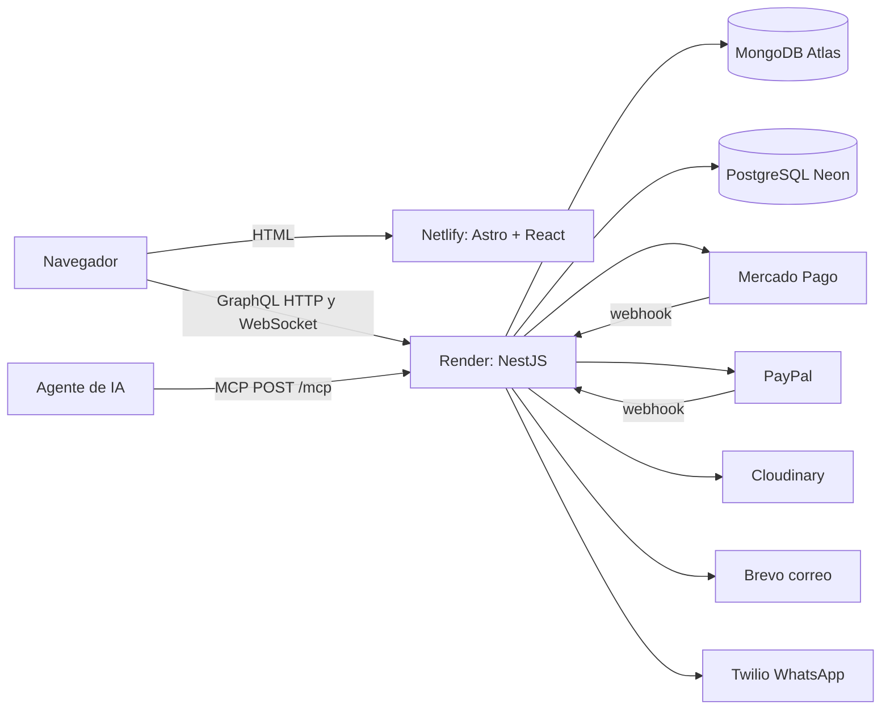

# Elixir - tienda en linea de licores

Proyecto integrador de Programacion Web 2 (CETI). E-commerce de licores con catalogo, carrito, pagos embebidos con Mercado Pago y PayPal, seguimiento de pedidos en tiempo real, panel de administracion y servidor MCP.

- Sitio: https://proyectow2.netlify.app/
- Autores: Diego Rafael Fernandez Rodriguez y Adrian Israel Aguirre Castillo

## Stack

| Parte | Tecnologia |
|---|---|
| Frontend | Astro 7 (output server, adaptador de Netlify) + islas de React 19, Zustand, Recharts |
| Backend | NestJS 12 (ESM) + GraphQL con Apollo (Query, Mutation y Subscription con graphql-ws) |
| Base no relacional | MongoDB Atlas con Prisma 5.22 (catalogo, usuarios, pedidos, pagos) |
| Base relacional | PostgreSQL en Neon con `pg` (bitacora de acciones del admin) |
| API para agentes | MCP (Model Context Protocol) de solo lectura en `POST /mcp` |
| Pagos | Mercado Pago (Payment Brick) y PayPal (botones y campos de tarjeta) |
| CI/CD | GitHub Actions + Netlify CLI + Render (Auto-Deploy despues del CI) |

## Arquitectura



## APIs y servicios de terceros

1. **Mercado Pago**: cobro con tarjeta, efectivo y cajero dentro de la tienda.
2. **PayPal**: cobro con cuenta PayPal o tarjeta.
3. **Cloudinary**: subida firmada y entrega optimizada de imagenes de productos.
4. **Brevo**: correo de recuperacion de contrasena y avisos de estado del pedido.
5. **Twilio (WhatsApp)**: avisos de estado del pedido por WhatsApp.

Infraestructura: MongoDB Atlas, Neon (PostgreSQL), Render y Netlify.

## Funciones principales

- Catalogo por categorias con filtros de mas vendidos, promociones y premium, y actualizacion en vivo.
- Verificacion de edad: aviso para visitantes, fecha de nacimiento obligatoria al registrarse y bloqueo de compra a menores de 18 (validado en el servidor).
- Carrito por usuario, reserva de stock por 30 minutos y expiracion automatica.
- Pago embebido sin salir de la tienda; webhooks verifican monto y moneda con el proveedor.
- Seguimiento del pedido en vivo (POR_PREPARAR, PREPARANDO, ENVIADO, ENTREGADO) con aviso por correo y WhatsApp.
- Panel de admin: resumen con graficas, productos, categorias, pedidos, pagos, facturas (CSV), usuarios y bitacora.
- Comprobante imprimible de compra.

## Estructura

```
P1P/
  .github/workflows/ci.yml   CI/CD
  back/                      API NestJS
    prisma/schema.prisma     modelos de MongoDB
    src/<modulo>/            un modulo por tema (auth, productos, pedidos, pagos, bitacora, mcp...)
    src/comun/               utilidades compartidas (ids, edad, telefono)
    test/                    pruebas de integracion
  front/                     sitio Astro
    src/pages/               rutas
    src/components/islands/  componentes React
```

## Instalacion local (Windows / PowerShell)

Requisitos: Node 24 y npm 11.

```powershell
# Backend
cd back
copy .env.example .env      # y llena los valores
npm install
npx prisma generate         # con el backend detenido
npm run start:dev           # http://localhost:3000/graphql

# Frontend (otra terminal)
cd front
copy .env.example .env
$env:NETLIFY_DEV = "1"
npm install
npm run dev                 # http://localhost:4321
```

Datos de demo (borra la base, no usar contra produccion): `cd back; npx prisma db seed`. Crea `admin@elixir.com` y `cliente@elixir.com` con clave `123456`.

## Pruebas y calidad

```powershell
cd back
npm run lint        # oxlint
npm test            # pruebas unitarias (Vitest)
npm run test:e2e    # arranca la app completa con una base falsa
npm run build
```

## CI/CD

`.github/workflows/ci.yml` corre en cada push y pull request a `main`:

1. **Backend**: `npm ci`, `prisma generate`, lint, pruebas unitarias, pruebas de integracion y build.
2. **Frontend**: `npm ci` y build.
3. **Despliegue** (solo push a `main` y si todo paso): el front se publica en Netlify con su CLI; Render publica el back porque su Auto-Deploy esta en "After CI Checks Pass".

Secretos de GitHub necesarios: `NETLIFY_AUTH_TOKEN` y `NETLIFY_SITE_ID`.

## Servidor MCP

`POST /mcp` (transporte Streamable HTTP, sin sesion). Herramientas de solo lectura:

| Herramienta | Que hace | Requiere sesion |
|---|---|---|
| `listar_categorias` | Lista las categorias | No |
| `buscar_productos` | Busca por texto, categoria, promocion o premium | No |
| `mas_vendidos` | Productos con mas unidades vendidas | No |
| `estado_pedido` | Estado de pago y envio de un pedido propio | Si (`Authorization: Bearer <token>`) |

Para probarlo: `npx @modelcontextprotocol/inspector`, transporte "Streamable HTTP" y URL `https://<backend>/mcp`.

## Variables de entorno

Ver `back/.env.example` y `front/.env.example`. Los valores reales van en `.env` (local), en Render y en Netlify; nunca en el codigo.

## Limitaciones conocidas

- Render gratis se duerme tras 15 minutos sin trafico y corta los WebSocket; las suscripciones usan PubSub en memoria (una sola instancia).
- La verificacion de edad es declarativa (fecha de nacimiento), como en tiendas reales; no valida identificacion oficial.
- El sandbox de WhatsApp de Twilio solo envia a numeros que se unieron al sandbox.
- El comprobante no es una factura fiscal (CFDI).
